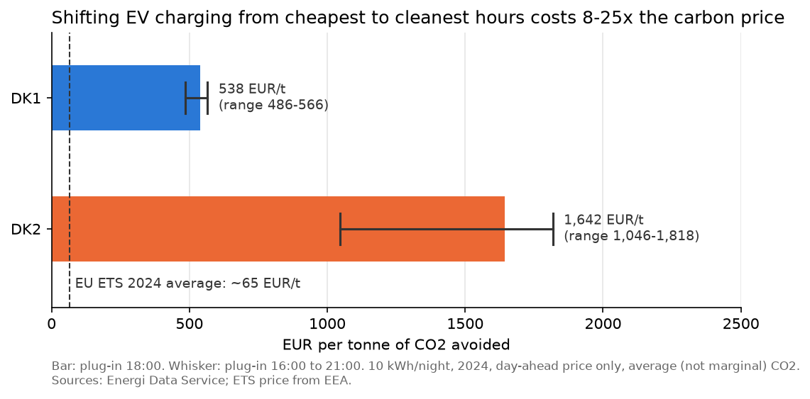

# Cheap vs. clean electricity in Denmark

**Question:** In Denmark, does chasing the cheapest hours also mean using the cleanest electricity, and when it doesn't, what does going green cost?

Hourly data for 2024, price areas DK1 (West Denmark) and DK2 (East Denmark), from Energinet's [Energi Data Service](https://www.energidataservice.dk/).

## Key findings

1. **Cheap is rarely clean.** On about 9 days in 10, the cheapest 4-hour window of the day is not the cleanest one (it is the same window on 11% of days in both areas).
2. **The gap is seasonal.** In winter the cheapest window is only slightly dirtier than the cleanest (median day: DK1 +24 g/kWh, DK2 +4 g/kWh). In summer the gap is large (DK1 +49 g/kWh, DK2 +23 g/kWh): at 14:00 the price is at its lowest and CO2 intensity at its highest.
3. **Why:** on summer nights Denmark imports Nordic hydro power. At summer midday cheap German and Dutch solar pushes Nordic imports out, and Denmark imports from Germany and the Netherlands, whose mix is more carbon-intensive.
4. **EV charging (10 kWh per night):** charging in the cheapest hour instead of at plug-in saves ~165-180 EUR/year. In DK1 it also cuts CO2 by ~7%; in DK2 it cuts no CO2 at all.
5. **Going from cheapest to cleanest hours costs ~540 EUR/t CO2 avoided in DK1 and ~1,640 EUR/t in DK2**, 8 to 25 times the 2024 EU ETS price (~65 EUR/t). The result holds for any plug-in time between 16:00 and 21:00.

## Charts

**In summer, the cheapest hours of the day are the dirtiest**

**The cheapest 4-hour window costs the most extra CO2 in spring and summer**

**EV charging: smart charging saves money everywhere, but CO2 only in DK1**

**Choosing clean over cheap hours costs 8 to 25 times the EU carbon price**

## Data

| Dataset | Content | Resolution |
|---|---|---|
| Elspotprices | Day-ahead price (EUR/MWh) | Hourly |
| ProductionConsumptionSettlement | Production by source, consumption, cross-border exchange (MWh) | Hourly |
| CO2Emis | CO2 intensity of consumed electricity, incl. imports (g/kWh) | 5-minute, averaged to hourly |

- Calendar year 2024: the last full year with hourly day-ahead prices (the market moved to 15-minute prices in October 2025).
- Final dataset: 8,783 of 8,784 hours per area, no missing values.
- EU ETS 2024 average price: 64.8 EUR/t ([EEA](https://www.eea.europa.eu/en/analysis/indicators/use-of-auctioning-revenues-generated)).

## Method

- **Time:** all hour-of-day and seasonal analysis in Danish local time. Winter = Dec, Jan, Feb; summer = Jun, Jul, Aug.
- **Daily window metric:** for each day and area, the cheapest and the cleanest 4 consecutive hours (by average price and average CO2 intensity). Windows may run past midnight.
- **EV simulation:** 10 kWh per night, 11 kW charger, plugged in 18:00 to 07:00. Charging takes under an hour, so each strategy picks one hour per night: at plug-in, the cheapest hour, or the cleanest hour. 365 nights per area. Cost uses the day-ahead price only.
- **Cost of CO2 avoided** = extra cost of cleanest vs cheapest charging / CO2 saved.
- **Sensitivity:** plug-in time varied from 16:00 to 21:00.

## Limitations

- **Average, not marginal, CO2 intensity.** "Avoided" CO2 is the average mix of the hour you charge in, not the change in emissions caused by shifting load. A marginal-emissions view could give a different answer.
- **Day-ahead price only.** Household bills add grid tariffs (with an evening peak), taxes and VAT. Including them would raise the cost of charging at plug-in.
- **CO2Emis is a real-time estimate**; Energinet states that errors are generally not corrected. Combined heat and power emissions are split with the 125% method.
- **Import emissions:** the import explanation depends on how CO2Emis assigns emissions to imported power, which I have not yet verified in Energinet's documentation. The same holds for the sign convention of the exchange columns (assumed: positive = import).
- **One EV, best case.** Picking the single best hour each night is the best case for flexibility; larger loads spread over more hours would narrow the gaps.
- **One year.** 2024 only; "winter" combines Jan-Feb 2024 and Dec 2024.
- Electricity Maps' historical data is not available on the free tier, so this uses Energinet's CO2Emis. A natural next step is to compare with flow-traced intensity.

## Repository

| File | Content |
|---|---|
| `01_get_data.ipynb` | Downloads the three datasets from the Energi Data Service API and merges them |
| `02_exploration.ipynb` | Exploration: correlations, DK1 vs DK2, negative prices, seasonal patterns, imports |
| `03_felxibility.ipynb` | Daily window metric, EV charging simulation, sensitivity check, charts |
| `data/` | Cached raw downloads and `merged.csv` (one row per hour per area) |
| `figures/` | Charts used above |

Each notebook ends with a markdown cell summarising its results.

## How to run

Requires Python with `pandas`, `matplotlib` and `requests`. The data is already in `data/`; to re-download, run `01_get_data.ipynb` (no API key needed for Energi Data Service).

## Author

Matteo Piccagnoni, MSc Business Analytics (DTU), Copenhagen.
